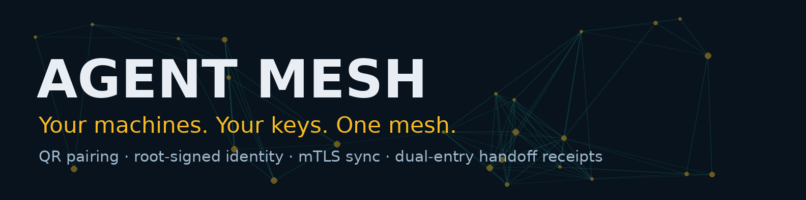
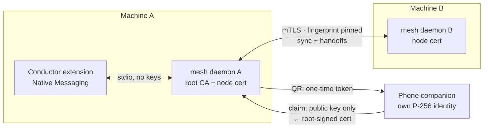

<p align="center">
  
</p>

<p align="center">
  
  = 18" src="https://img.shields.io/badge/node-%3E%3D18-2dd4bf">
  
  
  
</p>

# Agent Mesh

**A local-first trust layer for your own machines and agents.** Pair devices with a QR code, give every node a root-signed cryptographic identity, sync state over mutual TLS, and prove every handoff with a dual-entry receipt — no cloud account, no rendezvous server, no keys ever leaving the device that made them.

Agent Mesh is the node daemon behind **Mesh Mode in [Conductor](https://github.com/EdgeAgent/conductor)**, the AI browser agent. Conductor's browser joins the mesh through this daemon; other daemons join as full nodes; phones join as companions.

## Why this exists

Agents are starting to act across machines — a browser here, a runner there, a phone in your pocket. The moment they hand work to each other, three questions matter:

1. **Who is this node, really?** (Not "what IP did it come from.")
2. **Who authorized it to join?**
3. **Can both sides prove what was handed off?**

Agent Mesh answers all three with boring, verifiable cryptography instead of a platform account.

## How it works



- **Root of trust.** First run creates an Ed25519 root CA in `~/.meshnode` (key stored `0600`). Only the root can enroll a node. Nobody else can mint an identity in your mesh.
- **Pairing by QR.** The desktop displays a QR code carrying a **one-time token** (10 minutes, single use, in the URL fragment). The joining device generates its own keypair and submits **only its public key**; the root signs it into a node certificate.
- **Private keys never move.** They are generated on their device, stored on their device, and never returned by any interface. Peers and extensions see names and SHA-256 certificate fingerprints — that's it.
- **mTLS with pinned identity.** Node traffic is mutual TLS: the CA chain is validated by TLS **and** the peer's certificate fingerprint is pinned against the peer registry. An address is not an identity.
- **Dual-entry receipts.** Every enrollment, sync, and handoff appends to a hash-chained receipt log. A handoff counts as *proven* only when the sender's `HANDOFF` entry and the receiver's `RECEIPT` entry match on handoff hash + payload hash — each side holds proof the other can't rewrite.

## Quickstart

You need Node 18+ and OpenSSL (used for certificate issuance).

**One install (recommended)** — one script downloads the engine, registers it with Chrome, and enrolls this machine:

```sh
# Windows (PowerShell)
irm https://raw.githubusercontent.com/EdgeAgent/agent-mesh/main/install-mesh.ps1 | iex
# macOS / Linux
curl -fsSL https://raw.githubusercontent.com/EdgeAgent/agent-mesh/main/install-mesh.sh | sh
```

Then start the node with `node daemon.mjs serve` from the install folder and open Conductor's Mesh tab. Manual setup below does the same steps by hand.

**Machine 1 — create the mesh and start the node:**

```sh
git clone https://github.com/EdgeAgent/agent-mesh.git
cd agent-mesh
node daemon.mjs enroll --name "desktop"   # creates the root CA + this node's cert
node daemon.mjs serve                      # mTLS :47832 · pairing :47833
```

**Machine 2 — join as a full node:**

```sh
# on machine 1:
node daemon.mjs pairing-start              # prints a one-time token + claim URL
# on machine 2:
node daemon.mjs claim --url http://<machine-1>:47833/pair/claim --token <TOKEN> --name "laptop"
node daemon.mjs serve
```

**Prove a handoff (from machine 1):**

```sh
node daemon.mjs sync laptop        # fetch + verify the peer's receipt chain
node daemon.mjs handoff laptop     # HANDOFF → RECEIPT, returns proven: true
node daemon.mjs verify             # verify this node's own chain
```

**Phone — join as a companion:** in Conductor, open the **Mesh** tab and hit **Pair a device (QR)**, then scan. The companion page generates the phone's identity in the browser, enrolls it, and shows live node status plus a one-tap proven-handoff test. (Without Conductor, open the claim URL from `pairing-start` on the phone.)

**Conductor (browser node):** install the Native Messaging host once —

```sh
./install-native-host.sh           # macOS / Linux (Chrome + Chromium)
# Windows: powershell -ExecutionPolicy Bypass -File .\install-native-host.ps1
```

— then the Mesh tab in Conductor connects to this daemon. The extension holds **no keys**; with no daemon installed, the tab shows setup steps instead of pretending.

## Verified, not promised

The full loop was exercised end-to-end (2026-11-08): two daemons paired via the claim flow, synced over mTLS (peer chain verified), and exchanged a handoff whose dual-entry match was re-verified independently from both nodes' chain files. A phone-browser companion enrolled through the QR flow and triggered a proven handoff from its own UI. Unit tests cover the chain and the dual-entry proof: `npm test`.

## Honest limits

- **Root key custody.** The root key lives on the enrolling machine in this build. The stricter ceremony — root offline, enrollments signed by hand — is a documented hardening step, not yet the default.
- **LAN-first.** Discovery/pairing assume you can reach the host (same LAN, VPN, or tunnel). There is deliberately **no public rendezvous server**.
- **Browser companions** authenticate with a node-signed 24h session token (a phone browser can't run an mTLS listener); full nodes always use mTLS.
- **Certificate issuance** shells out to `openssl` today; a pure-JS issuer is on the roadmap.

## Files

| File | Role |
|---|---|
| `daemon.mjs` | The daemon: mTLS server, pairing server, Native Messaging host, CLI |
| `identity.mjs` | Root CA + node certificate issuance (keys never leave the mesh home) |
| `protocol.mjs` | mTLS client: status / sync / handoff with fingerprint pinning |
| `chain.mjs` | Hash-chained receipt log + dual-entry handoff matching |
| `companion.html` | The phone companion page served by the pairing endpoint |
| `install-native-host.*` | Per-user Native Messaging host install (sh / ps1) |

## License

MIT — see [LICENSE](LICENSE). Built by [Edge Agency](https://github.com/EdgeAgent).
